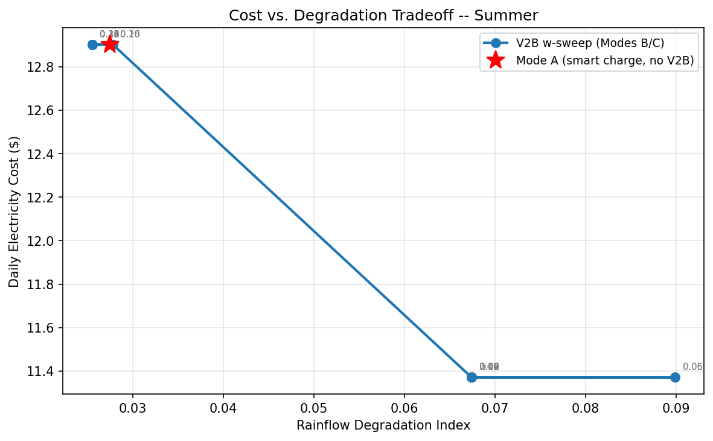
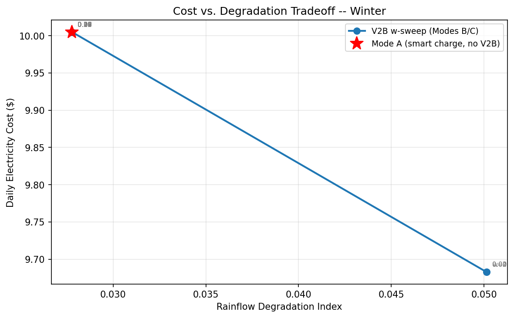
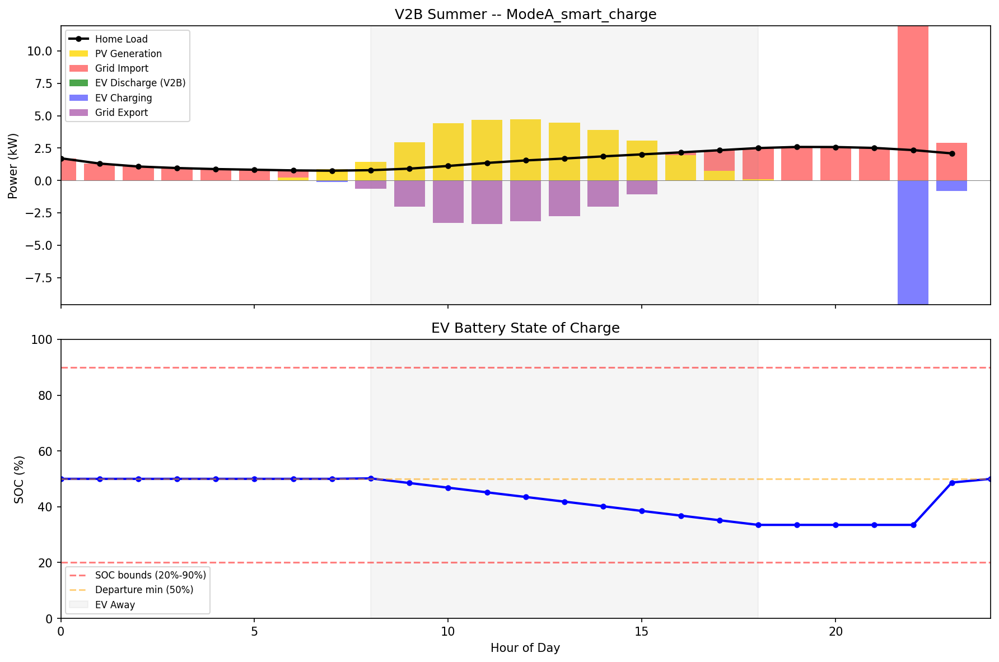
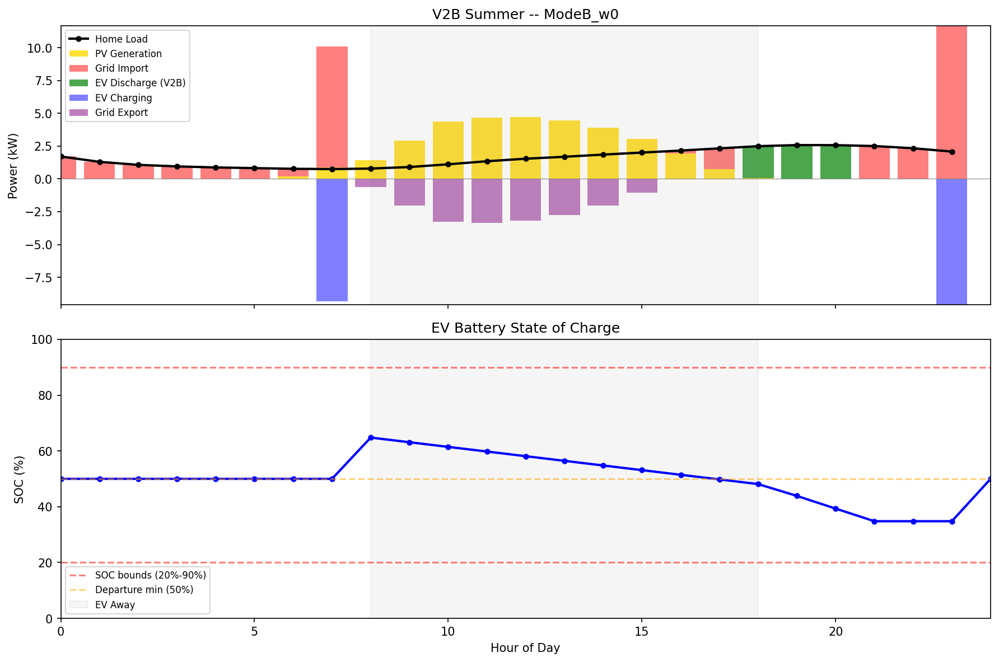

# Degradation-Aware V2B Dispatch

A mixed-integer linear program (MILP) that schedules hourly charging and discharging of a home EV battery alongside rooftop solar, and asks: **what happens to savings and battery wear when the optimizer is told that cycling the battery has a cost?**

Built with Pyomo + Gurobi for the Purdue Vertically Integrated Projects (VIP) ABC-PV team, mentored by Dr. Peter Bermel. Full write-up: [`docs/writeup.pdf`](docs/writeup.pdf).

## Key findings

- **V2B savings are seasonal.** Discharging the EV into the home cut daily electricity cost **11% in summer** ($12.90 → $11.37) but only **3.3% in winter** ($10.01 → $9.68). Typical TOU spreads don't make year-round V2B worthwhile.
- **A linear degradation penalty behaves like an on/off switch.** Sweeping the penalty weight `w` did not produce a smooth cost-vs-wear Pareto curve. V2B stays fully active until `w` crosses a threshold (≈ $0.10/kWh in summer, ≈ $0.05/kWh in winter), then shuts off completely.
- **Linear penalties hide most of the wear.** Post-hoc rainflow cycle counting on the resulting state-of-charge profiles shows V2B dispatch causes **~2.5–3.5×** the battery stress of the no-V2B baseline, because deep cycles do disproportionately more damage than a per-kWh throughput charge accounts for.

The takeaway: degradation-aware V2B needs a cycle-depth-aware (nonlinear) penalty inside the objective, not a flat throughput tax.

## System

```
    Sun ──▶ [ PV 6 kW ] ──▶ Home load
                               ▲
                               │
                  [ EV battery 60 kWh, 9.6 kW bidirectional charger ]
                               │
                               ▼
                    [ Grid, SCE TOU-D-4-9PM ]
```

| Parameter | Value |
|---|---|
| EV battery | 60 kWh, SOC bounds 20–90% |
| Charger | 9.6 kW bidirectional, 90% round-trip efficiency |
| Schedule | Leaves 8 AM (≥ 50% SOC), returns 6 PM, uses 10 kWh driving |
| Rates | SCE TOU-D-4-9PM; summer peak $0.58/kWh, winter peak $0.51/kWh |
| Export credit | Flat $0.05/kWh (NEM 3.0 approximation) |
| Days modeled | July 15 (summer), January 15 (winter), 1-hour steps |
| Location | Pasadena, CA |

## Model

Each run minimizes daily grid cost plus an optional battery-throughput penalty `w` ($/kWh):

$$
\min \sum_{t=0}^{23} \Big[ \pi^{buy}_t P^{buy}_t - \pi^{sell}_t P^{sell}_t + w \left( P^{ch}_t + P^{dis}_t \right) \Big]
$$

subject to, for each hour $t$:

- **Power balance:** $PV_t + P^{dis}_t + P^{buy}_t = D_t + P^{ch}_t + P^{sell}_t$
- **SOC dynamics (while home):** $SOC_{t+1} = SOC_t + \left(\eta P^{ch}_t - P^{dis}_t / \eta\right) / E$
- **No simultaneous charge/discharge:** $P^{ch}_t \le \bar{P}\,\delta_t$, $P^{dis}_t \le \bar{P}\,(1-\delta_t)$, $\delta_t \in \{0,1\}$
- **Trip:** no charging or discharging 8 AM–6 PM; $SOC_8 \ge 0.5$; $SOC_{18} = SOC_8 - 10/E$
- **Bounds:** $0.2 \le SOC_t \le 0.9$, $SOC_0 = 0.5$, $SOC_{24} \ge 0.5$

Three modes are compared:

| Mode | Description | Penalty |
|---|---|---|
| A | Smart charging only, no discharge to the home (baseline) | — |
| B | Unconstrained V2B | `w = 0` |
| C | Degradation-aware V2B, swept over 17 values | `w = 0.02 … 0.30` |

After solving, each SOC profile goes through [rainflow cycle counting](https://en.wikipedia.org/wiki/Rainflow-counting_algorithm), and a degradation index $\sum_i n_i \cdot DoD_i^2$ is computed so deeper cycles count more than shallow ones.

## Results

| Metric | Summer A | Summer B/C (w ≤ 0.095) | Winter A | Winter B/C (w ≤ 0.04) |
|---|---|---|---|---|
| Daily cost | $12.90 | $11.37 | $10.01 | $9.68 |
| V2B discharged | 0.00 kWh | 7.58 kWh | 0.00 kWh | 3.26 kWh |
| Rainflow degradation index | 0.0275 | 0.0674 | 0.0278 | 0.0502 |

Full output: [`results_summary.csv`](Results/run_20260403_132305/results_summary.csv), [`results.txt`](Results/run_20260403_132305/results.txt).

**Cost vs. degradation:** the sweep jumps between two points instead of tracing a curve.

<p>
  
  
</p>

**Summer dispatch, Mode A vs. Mode B:** with V2B, the EV charges overnight and discharges into the 4–9 PM peak.

<p>
  
  
</p>

### Limitations

- Two representative days, not a full year.
- The summer V2B schedule has several dispatches with identical cost. The solver picks one, so the rainflow index varies (0.067–0.090) at the same $11.37 cost. This spread is where the upper end of the 2.5–3.5× range comes from.
- The rainflow index is a relative stress measure, not a calibrated capacity-fade model.

## Running it

Requires Python 3.11+.

```bash
python -m venv venv && source venv/bin/activate
pip install -r requirements.txt
python main.py
```

No Gurobi license setup is needed. The `gurobipy` pip package includes a size-limited license, and this model (~140 variables) fits well within it. Each run writes plots, a CSV, and a text report to a new timestamped folder under `Results/`.

## Data

- **Solar:** [NREL PVWatts](https://pvwatts.nrel.gov/) hourly output for a 6 kW fixed array in Pasadena, CA (`Data/pvwatts_pasadena_hourly.csv`).
- **Household load:** [NREL ResStock](https://resstock.nrel.gov/) 2018 CA single-family detached aggregate (via [OpenEI](https://openei.org/)), scaled to one home with `units_represented`. Existing EV charging is subtracted so it isn't double-counted. The file is trimmed to the four columns the model uses (`Data/resstock_ca_sfd_load.csv`).
- **Rates:** [SCE Time-of-Use residential plans](https://www.sce.com/residential/rates/Time-Of-Use-Residential-Rate-Plans), TOU-D-4-9PM (hard-coded in `get_tou_prices`).

## References

1. J. Gong et al., "Quantifying the impact of V2X operation on electric vehicle battery degradation: An experimental evaluation," *eTransportation*, vol. 20, 2024. [doi:10.1016/j.etran.2024.100316](https://doi.org/10.1016/j.etran.2024.100316)
2. T. Fonseca et al., "EVLearn: Extending the CityLearn Framework with Electric Vehicle Simulation," 2024. [arXiv:2404.06521](https://arxiv.org/abs/2404.06521)
3. A. O. Ibrahim et al., "A scenario based analysis of bidirectional electric vehicle-building integration for energy optimization and carbon emission reduction," *Scientific Reports*, vol. 15, 2025. [doi:10.1038/s41598-025-31812-6](https://doi.org/10.1038/s41598-025-31812-6)
4. T. Fonseca et al., "EnergAIze: Multi Agent Deep Deterministic Policy Gradient for Vehicle to Grid Energy Management," 2024. [arXiv:2404.02361](https://arxiv.org/abs/2404.02361)
5. D. Fioriti et al., "Battery lifetime of electric vehicles by novel rainflow-counting algorithm with temperature and C-rate dynamics," *Journal of Energy Storage*, vol. 59, 2023. [doi:10.1016/j.est.2022.106458](https://doi.org/10.1016/j.est.2022.106458)
6. Y. Shi et al., "A Convex Cycle-based Degradation Model for Battery Energy Storage Planning and Operation," 2017. [arXiv:1703.07968](https://arxiv.org/abs/1703.07968)

## License

MIT
